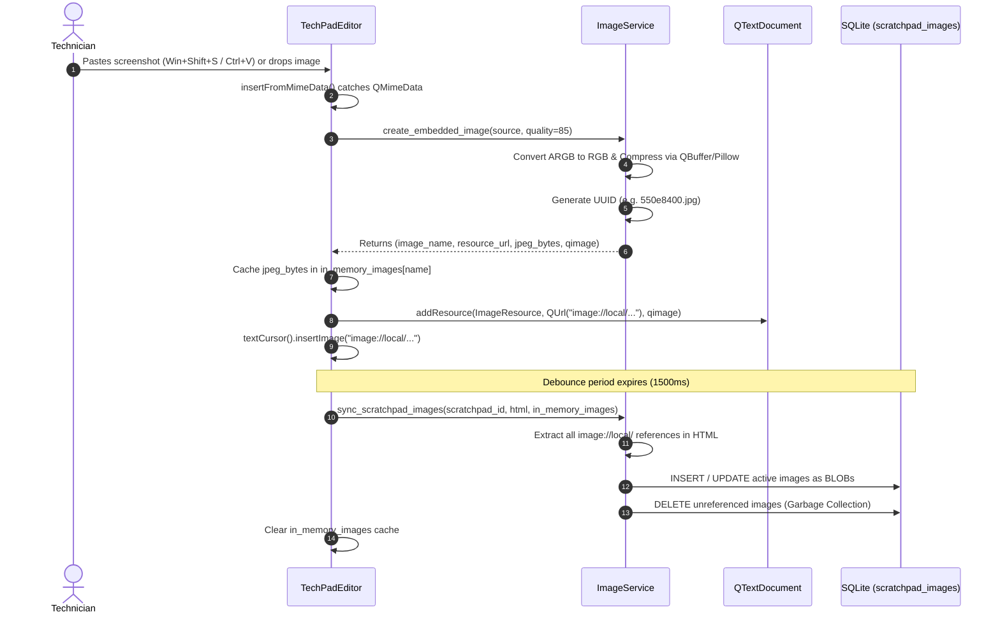

# Image Pipeline & Media Architecture

## 1. Overview
IT troubleshooting requires capturing log outputs, configuration windows, and error dialogs using screenshots (`Win + Shift + S`). Without compression, clipboard screenshots are stored as uncompressed 32-bit ARGB bitmaps (often 8–15 MB per capture), causing rapid database bloat.

T-Notes implements an optimized media pipeline that:
- Automatically intercepts clipboard pastes and drag-and-drop image files.
- Compresses images to JPEG with an 85% quality factor, preserving console font legibility while reducing payload sizes by 80–90%.
- Registers images directly into `QTextDocument` resource caches using an internal URI scheme (`image://local/<uuid>.jpg`).
- Synchronizes images with SQLite BLOB storage, automatically pruning unreferenced/deleted images.

---

## 2. Image Ingestion Lifecycle



---

## 3. Step-by-Step Breakdown

### Step 1: MIME Capture & Clipboard Interception
In `TechPadEditor`:
- Overrides `canInsertFromMimeData()` to accept images, URLs, and text.
- Overrides `insertFromMimeData()`:
  - If `source.hasImage()` is true (e.g., from `Win + Shift + S`), extracts `source.imageData()` as a `QImage`.
  - If `source.hasUrls()` is true, checks for local image file extensions (`.png`, `.jpg`, `.jpeg`, `.bmp`, `.gif`, `.webp`) and reads raw binary bytes.

### Step 2: JPEG Compression (Quality = 85)
In `ImageService`:
- If an alpha channel exists (`qimage.hasAlphaChannel()`), the image is composited against a clean white background to avoid transparent black artifacts when converting to JPEG.
- Compresses the image data into a `QByteArray` using Qt's `QBuffer` with `"JPEG"` format and quality `85`.
- Pillow (`PIL.Image`) is used as an additional fallback for arbitrary raw image byte buffers.

### Step 3: Resource Registration (`image://local/<uuid>.jpg`)
- A unique identifier is generated: `image_name = f"{uuid.uuid4().hex}.jpg"`.
- The resource URL is formed: `image://local/<uuid>.jpg`.
- Registered into the editor's document via:
  ```python
  document.addResource(QTextDocument.ImageResource, QUrl("image://local/<uuid>.jpg"), qimage)
  ```
- Inserted into the text flow via `cursor.insertImage("image://local/<uuid>.jpg")`.

### Step 4: Database Persistence & Garbage Collection
- During auto-save, `ImageService.sync_scratchpad_images()` parses the current HTML using regex (`src=["\']image://local/([^"\'>\s]+)["\']`).
- Any newly inserted images present in the document are written to `scratchpad_images` as binary BLOBs.
- **Garbage Collection:** Any previously stored image BLOB that is no longer referenced in the HTML (i.e. the technician pressed backspace and deleted the screenshot) is automatically deleted from `scratchpad_images`:
  ```sql
  DELETE FROM scratchpad_images
  WHERE scratchpad_id = ? AND image_name NOT IN (?, ?, ...);
  ```
  This guarantees that deleting screenshots from notes immediately reclaims database space.

---

## 4. Performance & Size Impact

| Capture Type | Raw Clipboard Size | Compressed JPEG (85%) | Reduction |
| :--- | :--- | :--- | :--- |
| Full 1080p Screenshot | ~8.3 MB (ARGB32) | ~180 KB – 320 KB | **~96%** |
| 4K Monitor Window Snip | ~16.5 MB (ARGB32) | ~450 KB – 750 KB | **~95%** |
| Terminal / CLI Error Snip | ~2.1 MB (ARGB32) | ~60 KB – 120 KB | **~94%** |

---

## 5. Image Export & Clipboard Copy (Context Menu)

When right-clicking directly on any embedded image in `TechPadEditor`:
- **Image Hit Detection (`_get_image_at_pos`):** Resolves the character format under cursor (and adjacent character positions) to verify `fmt.isImageFormat()`, retrieving the associated `QImage` directly from `QTextDocument.resource()`.
- **`📋 Copy Image`:** Copies raw uncompressed pixel data into the system clipboard via `QApplication.clipboard().setImage(qimage)`, enabling instantaneous pasting (`Ctrl+V`) into Slack, Teams, Outlook, Jira, or Paint.
- **`💾 Save Image As...`:** Prompts standard `QFileDialog.getSaveFileName` for PNG or JPEG export. If the user saves as JPEG, the original stored JPEG bytes are written directly without generational quality loss from re-compression.

---

## 6. Multi-Selection & Rich Text Clipboard Export (Base64 Embedding)

When users copy highlighted content containing both text, formatting, colors, and embedded images:
- **Challenge:** Qt's native `createMimeDataFromSelection()` generates HTML containing internal URI references (`.jpg">`). External applications (Microsoft Word, Outlook, Teams, Slack, Google Docs, Chrome, etc.) cannot resolve `image://local/` and will fail to display or drop the images.
- **Solution (`_enrich_html_with_base64_images`):**
  1. `TechPadEditor.createMimeDataFromSelection()` intercepts the HTML clipboard payload.
  2. Parses all `` tags and matches internal image resource names against `in_memory_images`, the database repository `scratchpad_images`, or `document().resource()`.
  3. Replaces internal references with self-contained **Base64 Data URIs** (`data:image/jpeg;base64,...`).
  4. Preserves all font colors, backgrounds, code blocks, and headings.
  5. If an image is selected alone without text, also provides raw bitmap data via `mime_data.setImageData(first_qimage)` for bitmap-only paste targets (e.g. Paint).
  6. Replaces the Unicode object replacement character `\uFFFC` in plain-text with `[Screenshot]` for clean terminal or Notepad pasting.
- **Full Note Copy (`copy_formatted_note`):** Clicking `📋 Copy Note` on the ribbon or pressing `Ctrl+Shift+C` packages the entire active document with Base64-embedded images and rich styles onto the clipboard.


## Atomic note save and cache ownership

The Notes save path extracts the `image://local/<name>` reference set and snapshots
the pending JPEG cache. HTML, referenced JPEGs and orphan cleanup commit in one
repository transaction. A reference must resolve to this ticket's existing BLOB
or its pending cache; another ticket's image never satisfies it. The independent
`sync_scratchpad_images` helper is retained for existing callers but is not used
by `ScratchpadService.save_content`. Failure preserves the original cache and
document. Only a committed receipt for the current editor revision clears them.
