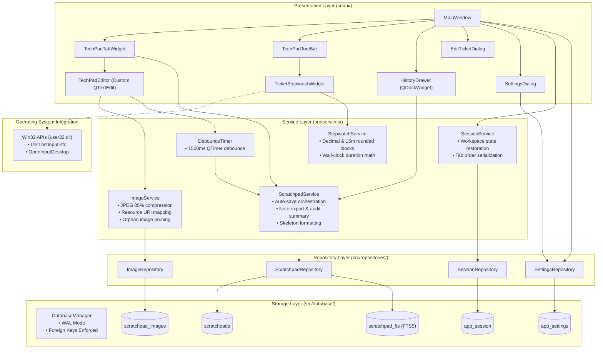

# System Overview & Architecture

## 1. Architectural Blueprint

T-Notes is engineered using a clean, layered architecture separating user interface presentation, business workflows, data access, and database storage.

---

## 2. Layer Boundaries & Responsibilities

### Presentation Layer (`src/ui/`)
- **Role:** Handles user input, window layouts, rendering, shortcuts, and event handling.
- **Rule:** UI components must **never** execute raw SQL queries. All data operations are delegated exclusively to `src/services/` or `src/repositories/`.
- **Components:**
  - `MainWindow`: Orchestrates application lifecycle, dock panels, opacity slider, settings modal, status bar, and central tabs. Houses application-wide `eventFilter` on `QApplication.instance()` to handle keyboard shortcuts across physical hardware modifier variations.
  - `TechPadTabWidget`: Movable, closable tabs with live running minutes (`#101 (14m) — Acme`) and context menu operations.
  - `TechPadEditor`: Subclass of `QTextEdit` intercepting clipboard images, drag-and-drop, and clickable URLs.
  - `TechPadToolBar`: Compact micro-controls for rich text, monospace code blocks, triage badges, and templates.
  - `TicketStopwatchWidget`: Toolbar component managing per-tab active troubleshooting duration, play/pause toggles, and MSP billing copy menus.
  - `HistoryDrawer`: Collapsible side drawer with real-time FTS5 search, ticket lifespan metadata, and tab restoration.
  - `SettingsDialog`: User configuration modal for ticket prefixes, auto-save debounce delay, JPEG quality, tab closure behavior, and default window opacity.

### Service Layer (`src/services/`)
- **Role:** Encapsulates business logic, data formatting, debounced auto-saving, media compression, session reconciliation, and billing math.
- **Components:**
  - `ScratchpadService`: Ticket CRUD, note conversion for PSA tools ("Copy for Ticket Note"), skeleton templates, and automated audit summaries.
  - `StopwatchService`: Calculates human-readable time strings (`HH:MM:SS`), decimal billing hours (`0.25h`), and 15-minute rounded MSP billing increments (`0.50h`).
  - `ImageService`: Image conversion, JPEG 85% compression, resource URL management, and synchronization/pruning.
  - `SessionService`: Loads and saves workspace session (active tabs, active index, window geometry, window opacity).

### Repository Layer (`src/repositories/`)
- **Role:** Manages SQL transactions, query parameterization, and row-to-dictionary mapping.
- **Rule:** Uses atomic transactions (`with connection:`) for all modifying operations.
- **Components:**
  - `ScratchpadRepository`: CRUD operations and FTS5 search queries.
  - `ImageRepository`: BLOB storage and cascading garbage collection.
  - `SessionRepository`: Singleton session row management.
  - `SettingsRepository`: Key-value storage for application preferences in `app_settings`.

### Database Layer (`src/database/`)
- **Role:** SQLite connection lifecycle, PRAGMA configuration, schema initialization, and migration execution.
- **PRAGMAs Enforced:**
  - `PRAGMA journal_mode = WAL;` (Write-Ahead Logging for high-concurrency read/write)
  - `PRAGMA foreign_keys = ON;` (Referential integrity and cascade deletion)
  - `PRAGMA busy_timeout = 5000;` (Graceful handling of locked databases)

---

## 3. Threading Model & System Event Interception

T-Notes operates within the standard PySide6 / Qt Event Loop:
1. **Main GUI Event Loop:** Handles keyboard strokes, mouse interactions, clipboard paste interception, cursor positioning, and UI rendering.
2. **Debounced Non-Blocking Writes:** Rather than writing to SQLite on every keystroke, user input triggers a 1500ms `DebounceTimer` (`QTimer.setSingleShot(True)`). The database transaction executes only after user typing pauses, ensuring the UI remains ultra-responsive.
3. **Synchronous Boundary Flushes:** To guarantee data safety, synchronous flushes are triggered upon:
   - Switching between tabs (`currentChanged`).
   - Closing an active tab (`tabCloseRequested`).
   - Window closing (`closeEvent`).
4. **Lightweight Transactions:** Because images are pre-compressed to compact JPEGs (typically 100–300 KB) and SQLite runs in WAL mode, database operations execute in milliseconds without freezing the main thread.
5. **Native Win32 Workstation Lock & Inactivity Auto-Pause:**
   A low-overhead 1-second pulse timer invokes Windows native APIs:
   - `user32.dll:GetLastInputInfo`: Measures idle milliseconds since last user keyboard or mouse input.
   - `user32.dll:OpenInputDesktop`: Verifies if the desktop is locked (`Win + L` or secure screensaver).
   If idle exceeds 300 seconds (5 minutes) or the session locks, active stopwatches pause automatically to prevent technician billing overages.
6. **Centralized Application Event Filter:**
   To guarantee shortcut execution regardless of which widget holds focus (e.g., inside `TechPadEditor` or `TechPadTabBar`), `MainWindow.eventFilter` is registered on `QApplication.instance()`. Modifiers are parsed with bitwise masks (`mods & Qt.ControlModifier`, `mods & Qt.ShiftModifier`), isolating hotkeys from keyboard driver flags such as `Qt.KeypadModifier`.

---

## 4. Application Lifecycle

### Bootstrap & Workspace Restoration Sequence
When `src/main.py` is executed:
1. `QApplication` is initialized with high-DPI scaling enabled.
2. Clean technician dark theme (`assets/styles/dark_theme.qss`) is loaded and applied.
3. `DatabaseManager` opens `techpad.db`, activates WAL mode, and verifies table schemas via `init_database()`.
4. `SessionService.restore_workspace()` runs:
   - Queries `scratchpads` for all records with `status = 'active'` ordered by `tab_order ASC`.
   - If no active scratchpads exist, an initial scratchpad (`INC-1001`) is automatically generated.
   - Restores window geometry and History Drawer visibility from `app_session`.
   - Opens each active ticket in its respective tab and restores the focused tab.

### Teardown & Exit Sequence
When the application receives a `closeEvent`:
1. `MainWindow.closeEvent` intercepts window closure.
2. `MainWindow.flush_all_saves()` immediately executes any pending debounced timers.
3. Tab order is serialized and updated in `scratchpads`.
4. The focused tab ID, window geometry hex string, and drawer visibility state are saved to `app_session`.
5. Database connections are closed cleanly.

