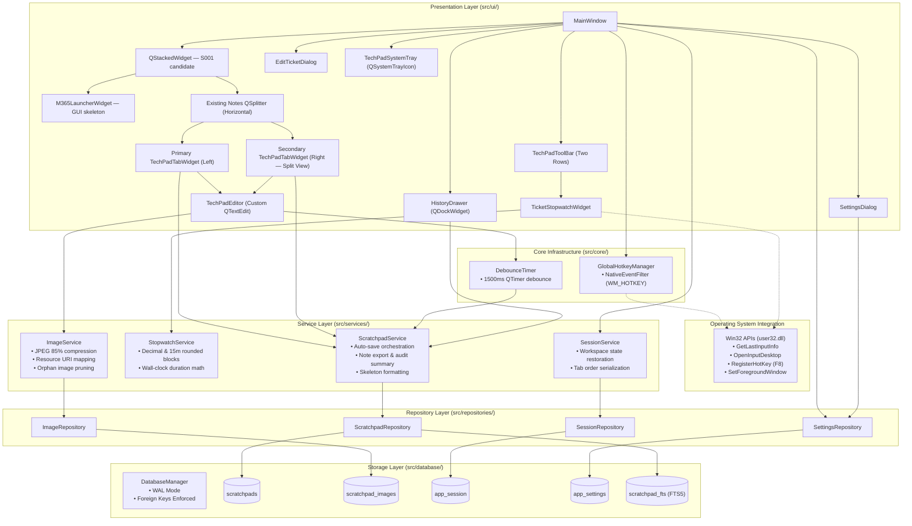

# System Overview & Architecture

## Offline M365 return validation boundary

The isolated S1 engine checks native PowerShell return types before JSON conversion,
then independently validates the return and selected payload schemas. The P2
correction rejects unsupported native objects, cycles and executable properties
without changing GUI dispatch or authentication. See the
[S1 engine topic](../features/m365-s1-engine.md#native-return-validation-correction).
This candidate requires independent rereview; S2/S3 and production dispatch remain gated.

## M365 company and identity preview

The launcher delegates session-only company/admin metadata and synthetic identity/
target context to Qt-independent services. CompanyContextPanel owns presentation
only; it has no Notes database or PowerShell capability. Graph and Exchange remain
separate fixture states and eligibility is always false. Production profile storage,
runtime authentication and engine integration remain gated. See the
[company directory](../features/m365-company-directory.md) and
[ADR 0010](../decisions/0010-m365-company-context-boundary.md).

## M365 workspace foundation and category catalog

S001 is merged into main. The category/catalog extension is an implementation
candidate pending independent review. The existing Notes workspace remains the
startup page.

During initial UI construction MainWindow adds its existing Notes QSplitter and
both original tab panes as page 0 of `workspace_stack` (QStackedWidget), then adds
one M365LauncherWidget as page 1 before installing the stack as central widget.
No existing central widget is deleted after installation. Editors, documents,
image caches, timers, services and database are not recreated or duplicated.

The accessible M365 Launcher button is positioned on the left side of the bottom status bar, placed 2nd between the HUD button and the Split button in both normal workspace mode and HUD mode. While viewing the M365 Launcher module, this button transforms into a 'T-Notes' button (`btn_m365`), remaining enabled to provide seamless bidirectional workspace toggling in normal mode as well as in HUD mode. Navigation
saves pending/dirty tickets by calling the existing `_execute_save` service path
directly: Qt signal callback exceptions cannot be relied upon to propagate through
the existing debounce flush. Dirty IDs clear only after successful content/image
persistence. Failure refuses navigation and retains the editor/cache for explicit
retry, even when the failed autosave's timer is already inactive.

Notes toolbars/history are hidden and note actions/shortcuts suspended during M365
display; Back restores their exact prior states. Page-only focus changes do not
pause/reload/restart the ticket stopwatch. F8 remains window-wide; Alt+T toggles Always-on-Top Mini-HUD mode across both Notes and M365 workspaces, and workspace switching preserves the active mode (normal or HUD). See tab-lifecycle.md and ADR 0008.

M365LauncherWidget exposes `back_requested`, `back_button`, `navigation`,
`content_layout`, `workspace_splitter`, `ticket_sidebar` and `ticket_panel_toggle`
for future expansion after independent review/approval. Fourteen flat categories
now come from an application-owned JSON registry through M365CatalogService.
The service provides schema-checked, unavailable-operation metadata snapshots;
the shipped production catalog is empty. Search, risk/lifecycle filters and
read-only plain-text details stay inside the existing scrollable shell. The
remaining execution/parameter/result placeholders remain unimplemented, while the
right ticket sidebar integrates the focused active ticket note from T-Notes using
shared document architecture (see [Active Ticket Sidebar](../features/editor-and-formatting.md#95-m365-active-ticket-right-sidebar--zero-lag-shared-document-architecture)).
No company persistence, credentials, worker/network dispatch, result parsing or
note insertion exists. The corrected proposed contract schemas are compatibility
inputs only, hash-bound for review and loaded only for nonempty catalogs. No
contract or offline engine is approved or integrated. See
[M365 catalog](../features/m365-catalog.md) and [ADR 0009](../decisions/0009-m365-metadata-catalog.md).

Alt+F8 is part of S001: one `workspace_shortcut` uses explicit
`Qt.ApplicationShortcut` context and disables auto-repeat. It has no parallel
Alt+F8 event-filter branch and no system-wide hotkey registration. The shortcut,
M365 Launcher signal and Back signal all call `switch_workspace()`, which chooses
the existing destination methods and their save/restoration paths. Modal dialogs,
shutdown, hidden/minimized windows and reentrant transitions refuse switching.
Editor-focus notifications during this shared transition cannot reload the timer.
When invoked from Mini-HUD, normal geometry/flags/visibility are restored before
showing M365. Existing F8, Alt+T and Alt+Z paths remain separate and unchanged.

## 1. Architectural Blueprint

T-Notes is engineered using a clean, layered architecture separating user interface presentation, business workflows, data access, and database storage.

---

## 2. Layer Boundaries & Responsibilities

### Presentation Layer (`src/ui/`)
- **Role:** Handles user input, window layouts, rendering, shortcuts, and event handling.
- **Rule:** UI components must **never** execute raw SQL queries. All data operations are delegated exclusively to `src/services/` or `src/repositories/`.
- **Components:**
  - `MainWindow`: Orchestrates application lifecycle, dock panels, opacity slider, settings modal, status bar, and central `QSplitter` hosting primary and secondary `TechPadTabWidget` instances for Split View. Houses application-wide `eventFilter` on `QApplication.instance()` to handle keyboard shortcuts across physical hardware modifier variations.
  - `TechPadTabWidget`: Movable, closable tabs with persistent ticket color ownership (12-color palette), live running minutes, dynamic task checklist progress badges (`☑️2/5`, `✅5/5`), rich tooltips, Split View pane migration, and context menu operations.
  - `TechPadEditor`: Subclass of `QTextEdit` intercepting clipboard images, drag-and-drop, clickable URLs, and interactive task checklists (`task://toggle` URI anchors with click toggling and smart Enter continuation).
  - `TechPadToolBar`: Reorganized two-row command ribbon: Row 1 for formatting, markup, and `☑ Checkbox`; Row 2 for stopwatch, templates, note copy, opacity, and preferences without artificial whitespace gaps.
  - `TicketStopwatchWidget`: Toolbar component managing per-tab active troubleshooting duration, play/pause toggles, and MSP billing copy menus.
  - `HistoryDrawer`: Collapsible side drawer with real-time FTS5 search, ticket lifespan metadata, and tab restoration.
  - `SettingsDialog`: User configuration modal for ticket prefixes, auto-save debounce delay, JPEG quality, tab closure behavior, and default window opacity.
  - `TechPadSystemTray`: System tray icon (`QSystemTrayIcon`) managing background execution, balloon notifications, and quick-action context menu.

### Core Infrastructure Layer (`src/core/`)
- **Components:**
  - `GlobalHotkeyManager`: Registers and unregisters system-wide global hotkeys via Windows API (`RegisterHotKey` / `UnregisterHotKey`) and routes `WM_HOTKEY` events through a `QAbstractNativeEventFilter`.
  - `DebounceTimer`: QTimer-based 1500ms debounce helper for responsive typing and persistence.

### Service Layer (`src/services/`)
- **Role:** Encapsulates business logic, data formatting, debounced auto-saving, media compression, session reconciliation, and billing math.
- **Components:**
  - `ScratchpadService`: Ticket CRUD, note conversion for PSA tools ("Copy for Ticket Note" with Markdown checklist conversion), skeleton templates, and automated audit summaries.
  - `StopwatchService`: Calculates human-readable time strings (`HH:MM:SS`), decimal billing hours (`0.25h`), and 15-minute rounded MSP billing increments (`0.50h`).
  - `ImageService`: Image conversion, JPEG 85% compression, resource URL management, and synchronization/pruning.
  - `SessionService`: Loads and saves workspace session (active tabs, active index, window geometry, window opacity).

### Repository Layer (`src/repositories/`)
- **Role:** Manages SQL transactions, query parameterization, and row-to-dictionary mapping.
- **Rule:** Uses atomic transactions (`with connection:`) for all modifying operations.
- **Components:**
  - `ScratchpadRepository`: CRUD operations and FTS5 search queries.
  - `ImageRepository`: BLOB storage and cascading garbage collection.
  - `SessionRepository`: Singleton session row management.
  - `SettingsRepository`: Key-value storage for application preferences in `app_settings`.

### Database Layer (`src/database/`)
- **Role:** SQLite connection lifecycle, PRAGMA configuration, schema initialization, and migration execution.
- **PRAGMAs Enforced:**
  - `PRAGMA journal_mode = WAL;` (Write-Ahead Logging for high-concurrency read/write)
  - `PRAGMA foreign_keys = ON;` (Referential integrity and cascade deletion)
  - `PRAGMA busy_timeout = 5000;` (Graceful handling of locked databases)

---

## 3. Threading Model & System Event Interception

T-Notes operates within the standard PySide6 / Qt Event Loop:
1. **Main GUI Event Loop:** Handles keyboard strokes, mouse interactions, clipboard paste interception, cursor positioning, and UI rendering.
2. **Debounced Non-Blocking Writes:** Rather than writing to SQLite on every keystroke, user input triggers a 1500ms `DebounceTimer` (`QTimer.setSingleShot(True)`). The database transaction executes only after user typing pauses, ensuring the UI remains ultra-responsive.
3. **Synchronous Boundary Flushes:** To guarantee data safety, synchronous flushes are triggered upon:
   - Switching between tabs (`currentChanged`).
   - Closing an active tab (`tabCloseRequested`).
   - Window closing (`closeEvent`).
4. **Lightweight Transactions:** Because images are pre-compressed to compact JPEGs (typically 100–300 KB) and SQLite runs in WAL mode, database operations execute in milliseconds without freezing the main thread.
5. **Native Win32 Workstation Lock & Inactivity Auto-Pause:**
   A low-overhead 1-second pulse timer invokes Windows native APIs:
   - `user32.dll:GetLastInputInfo`: Measures idle milliseconds since last user keyboard or mouse input.
   - `user32.dll:OpenInputDesktop`: Verifies if the desktop is locked (`Win + L` or secure screensaver).
   If idle exceeds 300 seconds (5 minutes) or the session locks, active stopwatches pause automatically to prevent technician billing overages.
6. **Centralized Application Event Filter:**
   To guarantee shortcut execution regardless of which widget holds focus (e.g., inside `TechPadEditor` or `TechPadTabBar`), `MainWindow.eventFilter` is registered on `QApplication.instance()`. Modifiers are parsed with bitwise masks (`mods & Qt.ControlModifier`, `mods & Qt.ShiftModifier`), isolating hotkeys from keyboard driver flags such as `Qt.KeypadModifier`.

7. **System-Wide F8 Global Hotkey Interception:**
   `GlobalHotkeyManager` invokes Windows `user32.dll:RegisterHotKey` for virtual key `VK_F8 (0x77)` with `MOD_NOREPEAT`. When pressed anywhere across the OS, `WinNativeHotkeyFilter` intercepts the `WM_HOTKEY` (0x0312) message and invokes `MainWindow.toggle_window_visibility()`, seamlessly popping the window to the foreground or minimizing it out of the way.

---

## 4. Application Lifecycle & Background Tray Execution

### Bootstrap & Workspace Restoration Sequence
When `src/main.py` is executed:
1. `QApplication` is initialized with high-DPI scaling enabled and `app.setQuitOnLastWindowClosed(False)` so closing the window keeps the tray icon active.
2. Clean technician dark theme (`assets/styles/dark_theme.qss`) and custom app icon (`assets/icons/app_icon.png`) are loaded.
3. `DatabaseManager` opens `techpad.db`, activates WAL mode, and verifies table schemas via `init_database()`.
4. `MainWindow` initializes the two-row toolbar, system tray icon, and registers the global `F8` hotkey.
5. `SessionService.restore_workspace()` and Split View restoration runs:
   - Queries `scratchpads` for all records with `status = 'active'` ordered by `tab_order ASC`.
   - If no active scratchpads exist, an initial scratchpad (`INC-1001`) is automatically generated.
   - Restores window geometry, window opacity, and History Drawer visibility from `app_session`.
   - In single-pane mode, populates the primary tab bar in exact saved tab order and selects the active tab.
   - In Split View mode (`split_view_active = 1`), allocates tickets between the primary and secondary tab widgets according to `primary_scratchpad_ids` and `secondary_scratchpad_ids` in their exact respective orders, restores the active tab in both panes, sets focus to the logical active editor, and applies saved horizontal splitter dimensions (`split_sizes`).

### Close to Tray Workflow
When the technician clicks the window close button (`✕`):
1. `MainWindow.closeEvent` intercepts closure.
2. `MainWindow.flush_all_saves()` immediately executes all pending debounced timers.
3. Current tab order and active session state are serialized and stored to SQLite.
4. If the system tray icon is active and `_force_quit` is False:
   - `event.ignore()` cancels termination.
   - The main window hides (`self.hide()`) and continues running in the system tray.
   - A one-time balloon tip notifies the technician: *"TechPad Running in Background — Press F8 anytime to show or hide."*

### Explicit Teardown & Exit Sequence
When the user selects **✕ Quit TechPad** from the system tray context menu or invokes `quit_application()`:
1. `_force_quit` flag is set to True.
2. `GlobalHotkeyManager.unregister()` unregisters the `F8` hotkey from Windows.
3. Active stopwatch timers are paused and final elapsed durations persisted to SQLite.
4. Tray icon is hidden, window is closed, and `QApplication.quit()` terminates cleanly.

### Save Barrier & Data-Loss Protection
- Before switching workspaces (`show_m365_workspace()`) or terminating the application (`closeEvent()`), `flush_all_saves()` collects all active debounce timers and dirty tickets.
- If persistence fails or dirty tickets remain, the status indicator updates to `● Save Failed` (bold red), workspace switching is refused, and `closeEvent` ignores the close event (`event.ignore()`) to keep the window open and preserve all in-memory drafts and images.
- Logical active ticket identity is tracked continuously via `_logical_active_scratchpad_id` across tab switches, pane changes, and editor focus events, ensuring closing the application while in the M365 workspace correctly persists the active ticket across sessions.

---

## 5. Viewport Constraints & Responsive Desktop Geometry

### Workspace Minimum Sizing Boundaries
- **Notes Workspace:** `660x400` logical pixels. Tailored for portrait monitors (e.g. physical resolution 1050x1680 at 150% Windows scaling, providing ~700px viewport) without clipping toolbars or editors.
- **Mini-HUD Mode:** `340x200` minimum logical pixels. Dynamically docks as an elongated right sidebar (`440px` width) pinned always-on-top. Hides both Row 1 and Row 2 toolbars (`self.toolbar` and `self.toolbar.secondary_toolbar`) and the history drawer to maximize note space and eliminate toolbar horizontal size constraints. If the window was maximized prior to toggling HUD, it is normalized to restore native border resizing handles, and the maximized state is restored upon exiting HUD. Resolves the active screen via `_get_hud_screen()` (evaluating title bar top-center before window center) to seamlessly support multi-monitor setups with disparate coordinates (e.g. upper portrait monitors with negative Y bounds). Compensates for native window frame decorations (`title_h` and `extra_h`) to bound height to `avail.height() - extra_h`. Window position is completely unconstrained during user drags (`moveEvent` updates `maximumHeight` for the active screen without touching `x` or `y`, preventing drag loop fighting and flashing), while `resizeEvent` cleanly clamps height against the taskbar (`_clamp_hud_height_to_taskbar`) if resized downwards into the taskbar area. Suppresses responsive history and split auto-expansion while in HUD mode. Features a left-side bottom bar cluster at the same left emplacement as normal mode (in T-Notes: `HUD`, `M365 Launcher`, `Split`, `History`; in M365: `HUD`, `T-Notes`, `Categories`, `Active Ticket`), ensuring immediate 1-click workspace restoration and bidirectional panel toggling without manual resizing.

### Desktop Work-Area Clamping (`_clamp_geometry_to_screen`)
- Window geometry is bounded using `screen.availableGeometry()` on startup, HUD exit, and resize events.
- Coordinates are clamped:
  - `max_x = avail.x() + avail.width() - new_w`
  - `max_y = avail.y() + avail.height() - new_h`
  - `new_x = max(avail.x(), min(geo.x(), max_x))`
  - `new_y = max(avail.y(), min(geo.y(), max_y))`
- This ensures the application never spawns or restores off-screen when moving across multi-monitor setups with disparate scaling factors or resolutions.

### Status Bar Contraction (`CompactLabel`)
- The active ticket information label in the status bar subclasses `CompactLabel(QLabel)` with a horizontal `minimumSizeHint` width of 0.
- This relaxes the status bar's minimum size from >800px down to ~380px, eliminating right-edge clipping on narrow monitors.

