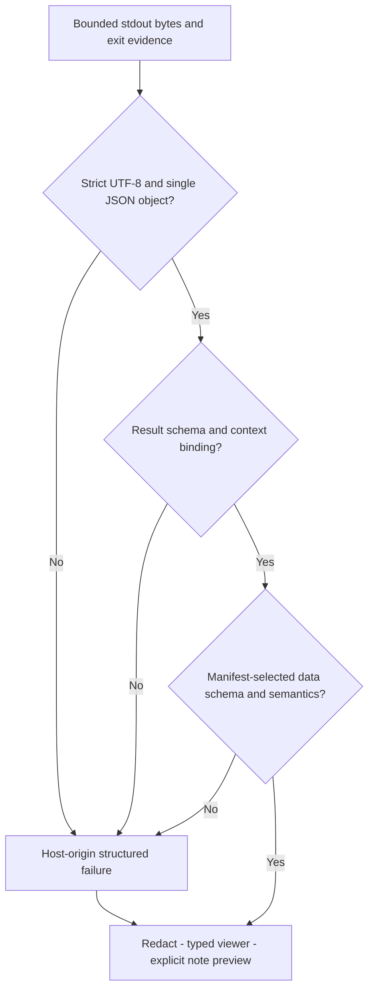

# T-Notes PowerShell shared contract — official 0.3.0

Identifier: `tnotes.m365`. Status: **RELEASE CANDIDATE — INDEPENDENT REVIEW REQUIRED**.
Required status after independent release approval: **APPROVED — IMPLEMENTATION CONTRACT**.
This document and the matching schemas form the authoritative contract baseline for future
Microsoft 365 PowerShell development. Examples are synthetic, not approval.
Authoritative contract entrypoint: `docs/contracts/m365/CONTRACT.md`.
Technical contract approval remains strictly separate from authorization for live tenant execution.

## Version reconciliation and authority

The prompt's older `0.1.0-draft`/`0.1.0` discrepancy is documented in the preserved
snapshot. Actual packaged shared CONTRACT and three schemas use `1.0.0-draft.1`.
Neither family is an approved baseline. Choose **0.3.0** consistently as the promoted
official baseline (migrated from `0.3.0-proposed.1`), not an assertion that either
old family was deployed.
This correction replaces the incompatible 0.2.0-proposed.1 review candidate;
its original validation reports remain historical evidence for those older bytes.
All schemas, requests, results, manifests, profiles and fixtures use that exact
string. No implicit downgrade, alias or acceptance of a different draft.

| Discrepancy | Proposed resolution |
|---|---|
| `request_id` versus `correlation_id` | correlation_id UUID everywhere |
| `failed` versus `error`/timeout | success, partial, error, cancelled, timeout |
| `.psm1` versus four `.ps1` files | One reviewed `.ps1` operation returning one typed object to host; fixed host adapter owns JSON |
| Script JSON versus host serialization | Exactly one **host-adapter** wire envelope per operation; no operation stdout serialization |
| `read/change` versus `read_only/write` | read_only, write, high_impact |
| Multiple timestamp naming conventions | started_at/completed_at UTC RFC3339 with terminal Z; duration_ms nonnegative integer |
| Absent operation schemas/manifest detail | Explicit manifest/request/result/error/company/data schema set with bounded payloads |
| Missing versus verified context | context_state and nullable actual tenant; never echo selected tenant as verified |

Approval binds exact artifact hashes and semantic decisions, not just a version
label. Any prerelease revision changes the exact string in all artifacts and
requires revalidation/review. Proposed incompatible pre-1.0 changes increment the
minor version; nonbreaking corrections increment proposal suffix. A stable release
such as 0.3.0 requires an explicit synchronized release decision, not string stripping.
After 1.0, breaking/minor/patch SemVer policy must include coordinated consumers
and migration/compatibility fixtures. Old drafts remain intact and incompatible.

Project priority: explicit user requirements; approved architecture; approved
PowerShell contracts/schemas; AGENTS.md/scoped rules; GEMINI.md; validated code.
No proposal or implementation can self-certify its approval. Report contradictions
without silently choosing a weaker boundary. Existing AGENTS service-only UI
boundary remains protected while system-overview wording is reconciled.

## Schema inventory and validation order

JSON Schema Draft 2020-12; additionalProperties=false for protocol objects and
typed payloads. `common.schema.json` owns shared types; the six entry schemas
reference its registered local identity. IDs under `https://tnotes.invalid/` are
identifiers only: resolve exclusively from the reviewed local schema inventory,
never fetch remote schemas at runtime. External/user-supplied $ref is forbidden.

| Schema | Required concepts |
|---|---|
| common.schema.json | Shared wire types, callable context/return, connection/trust/eligibility and RAM history records |
| script-manifest.schema.json | contract/script/version, title/description/category, path and integrity, PS/modules, execution/connections/scopes/RBAC/risk, parameters, payload ref, timeout/cancel/sensitivity/approval |
| execution-request.schema.json | correlation/script, company/actual tenant/admin ref/generation/target/ticket, parameters, execution mode, authorization ref |
| execution-result.schema.json | Frozen identity/release binding, actual tenant/context, origin/outcome/status/logical exit, timing, typed data/warnings/errors, optional safe diagnostics |
| error.schema.json | Stable sanitized code/message/retry metadata |
| company-profile.schema.json | Non-secret company identity, tenant, admin hint and bounded preferences |
| operation-data.schema.json | Exact output objects for the four User Snapshot operations |

First validate catalog trust and manifest schema, then request schema and
manifest-specific parameter rules; verify current identity/auth/approval; after
dispatch validate strict JSON, result schema, correlation/context/status/timing,
and the manifest-selected data schema. Schema shape alone proves neither
permissions, trust, target truth, absence of secrets nor operational success.

## Manifest contract and discovery

Mandatory fields are listed in the schema's required array. subcategory and tags
are optional display metadata; approval and sensitivity declarations are required.
All execution-affecting metadata is required, even when an array is empty. Optional
fields omitted are not inferred from display names. Duplicate script IDs reject
catalog registration. script_id is stable `M365.<SERVICE>.<OPERATION>`; version
and SHA-256 change when executable bytes change. Hash approval is external to the
manifest. Fixture hashes are simulated and approve no executable.

Paths use canonical `/`-separated relative segments without dot segments, percent
encoding, colons or backslashes. Resolve script_path against the approved catalog
root, output_schema against the approved contract root, verify filesystem
containment/reparse state and trusted release identities, and check again at use.
Scripts/modules are never imported during discovery. Exact PS7/module compatibility
and tested versions belong to future release evidence; no module auto-install.

`target_policy.accepted_kinds` declares one or both of upn/object_id;
`requires_resolved_identity` requires a current tenant/generation-bound identity
resolution record before dispatch. These are execution metadata, never inferred
from script ID, title, category or a four-script switch. Identity accepts either
kind; the three follow-on Snapshot operations accept only the resolved object ID.
A new trusted script may explicitly accept UPN without being an identity script.
The host does not silently convert identifiers: a separately approved resolution
step changes the effective request, preview and authorization binding first.

`connection_requirements` names every required service. `graph_scopes` applies
only to Graph; nonempty scopes without Graph are invalid metadata. `required_roles`
is a list of service-qualified requirement groups `{service, any_of}`. All groups
must be met; one independently verified effective role/capability in each any_of
group suffices. Unknown capabilities are unverified and block execution. Labels
such as "Reader or equivalent" are not machine-verifiable permission identifiers.
Each role's service must appear in connection_requirements. Scope consent never
establishes RBAC. No metadata can grant permissions or install modules.

The host computes a `common#/$defs/eligibility` object for display and dispatch.
It contains `eligible` and a list of safe `{code,message}` disabled reasons.
Eligible is true exactly when reasons is empty. Evaluate schema/version, descriptor
consistency, external trust, supported PS/modules, current target kind/resolution,
every required service's state/ownership/actual identity/expiry, scopes, effective
roles, effective parameters and risk/confirmation policy. Show every applicable
reason (bounded to 30), including unavailable permission evidence. Missing target,
wrong kind, expired connection and untrusted executable must never display Run as
enabled. Recompute on any relevant state change and recheck at dispatch; a UI
eligibility object is advisory and cannot authorize calls. Favorites use the same
gates. Corrupted manifests remain quarantined rather than partially interpreted.

`expected_output_schema` is an exact local schema path and JSON Pointer into the
approved schema registry. Reject absent fragments/unknown refs and hash mismatches
before dispatch. Bind the schema hash through release_binding. Validate every
non-null returned data object against that selected definition, in addition to
the envelope. Never select output shape by script ID or trust a result's choice.
`examples/mock-compatibility.json` includes an additional synthetic script ID to
demonstrate discovery and target eligibility without modifying host dispatch code.

Parameters are a bounded list of unique named typed descriptors. Supported types:
string, integer, number, boolean, string_array. Required omission, unknown names,
wrong types (including bool-as-integer), out-of-bounds values and inconsistent
defaults are rejected. Host applies approved defaults before preview and freezes
the effective parameter set. Optional parameters remain omitted unless an approved
default is explicit; never invent null or a default. No regex/code expressions
in parameter metadata. A newly required parameter type needs schema/UI review.

Descriptor rules (I2): names are unique under case-insensitive PowerShell binding;
Context, Parameters and CancellationToken and all PowerShell common parameter
names are reserved. minimum/maximum apply only to integer/number; min_length and
max_length only to string. string_array uses min_items/max_items and
item_min_length/item_max_length, never string-length or numeric constraints.
Defaults and allowed_values must have exactly the declared type (boolean is not
integer), be finite, satisfy all bounds and contain no duplicates. allowed_values
is unsupported for string_array in this version. Every scalar allowed value must
itself satisfy the bounds. A default must belong to allowed_values when present.
Reject inverted length/item/numeric ranges, fractional integer bounds and invalid
defaults even when the offending parameter is optional or absent from the request.
Schema handles type applicability; semantic catalog validation handles relational
bounds and case-insensitive/reserved names. Invalid descriptors quarantine the
entire manifest before building forms. No ignored incompatible constraints.

## Callable ABI v1 (B1, normative)

Python sends the validated `execution-request` as one UTF-8 JSON line on the
owned worker's stdin. It never invokes an operation directly. The fixed reviewed
PowerShell adapter resolves the approved manifest and calls exactly:

```powershell
# Signature required at the top of each future operation .ps1; specification only.
[CmdletBinding()]
param(
    [Parameter(Mandatory)]
    [System.Collections.Generic.IReadOnlyDictionary[string,object]] $Context,
    [Parameter(Mandatory)]
    [System.Collections.Generic.IReadOnlyDictionary[string,object]] $Parameters,
    [Parameter(Mandatory)]
    [System.Threading.CancellationToken] $CancellationToken
)
# Adapter invocation shape (not an executable implementation in this package):
# & $ApprovedOperationPath -Context $FrozenContext -Parameters $FrozenParameters `
#     -CancellationToken $OwnedCancellationToken
```

All three parameters are mandatory, even an empty Parameters dictionary. No other
operation parameters, positional arguments, dynamic parameters or pipeline input
are allowed. The adapter converts JSON strings to System.String, integer to
System.Int64, number to finite System.Double, boolean to System.Boolean, and
string_array to a read-only list of System.String. It rejects conversion overflow;
it never relies on PowerShell's implicit string/bool/array coercion. Parameters
contains only effective approved manifest parameters, with defaults already bound.
The outer dictionaries and every nested dictionary/list are read-only copies;
scripts cannot mutate host state through an exposed mutable nested object.

Context has exactly the fields of `common#/$defs/invocation_context`: the frozen
request identity and release binding, actual `verified_account_upn`, target,
nullable ticket context, plus required-service `connections`. Each connection is
a credential-free lease record with service, opaque connection_id, owner_worker_id,
company/tenant/admin reference/generation/account binding, state, verified_at,
nullable expires_at, Graph scopes and verified effective service roles. Dates are
UTC strings. This is local adapter state, never caller-supplied proof. No token,
credential, SDK object, mutable connection handle or callable is passed to scripts.

The adapter verifies actual Graph tenant/account and its owned Exchange connection
immediately before invocation, reconstructs Context from its registry, and compares
it to the Python snapshot. All required services must match company, tenant,
account and generation; unverified/expired/mismatched/foreign leases block calls.
The same verification is required before accepting returned data. A changed lease
discards candidate data and yields a sanitized host failure with unknown outcome
if dispatch occurred. The initial worker belongs to one company/account/generation
and may own both services; it executes one operation at a time in the runspace
holding those connections. Connection IDs must match that runspace's registry.
The adapter alone connects, revalidates, reconnects and disconnects its own leases.
Scripts never authenticate, select a different connection or disconnect sessions.

An operation emits exactly one System.Management.Automation.PSCustomObject on
the success stream, with exactly `status`, `operation_outcome`, `data`, `warnings`,
`errors` as defined by `common#/$defs/operation_return`. Data is a typed PSCustomObject
with JSON-compatible properties matching the manifest's output definition, or null.
Warnings/errors are object arrays even for zero/one entry. Scripts return structured
expected failures; unexpected terminating exceptions and non-terminating error
records are caught by the adapter and mapped to sanitized INTERNAL_ERROR (no raw
exception). Extra pipeline output, unsupported types, enum/date objects left
unnormalized, missing fields or inconsistent return objects are CONTRACT_VIOLATION.
The adapter captures all PowerShell streams; verbose/debug/information/progress
never reach wire stdout, and error records cannot coexist with a claimed success.

`success/succeeded` requires valid non-null data and zero errors;
`partial/partially_succeeded` requires valid non-null data plus a warning/error;
`error/failed|not_started|unknown` requires null data and at least one error.
Partial data obeys the full selected payload schema; unavailable required values
use only documented nulls. CancellationToken is checked before the first provider
call and between bounded batches. OperationCanceledException maps to CANCELLED,
null data and not_started before any call, otherwise unknown. Scripts must never
call exit, serialize JSON, write app files/SQLite, install modules or launch children.

The adapter owns envelope identity, actual verification state, timestamps and exit
mapping; it validates operation_return and the selected payload before serialization.
Request and result echo the exact release_binding (script version/hash, manifest
hash and output-schema hash) and admin reference/generation/target. The Python host
compares these to its retained dispatch snapshot, never to current GUI selection.
Host failures echo request identity but use tenant_id=null when actual verification
cannot be established. An identity echo itself establishes no verification.

Persistent worker operations do not exit the process: `operation_exit_code` in the
envelope carries 0/2/10/20/30/40/50 according to the exit table. A healthy worker
shutdown exits 0; a crash/nonzero process exit is separate transport evidence and
invalidates any pending success. Unexpected EOF, missing/extra response, malformed
output or a logical-code mismatch is a host CONTRACT_VIOLATION, outcome unknown
after dispatch. A fully validated response committed by the supervisor before a
cancel/deadline event wins; otherwise cancel/timeout is terminal, late data is
discarded, and an owned process may be terminated after five seconds. Completed
workflow sections remain historical evidence, never partial bytes from a killed
operation. No automatic retry or rollback claim follows any process outcome.

The JSON-only `examples/mock-compatibility.json` models both sides of this call.
It executes no operation and is not a production adapter.

### Cancellation control frame and worker shutdown

Python's future `cancel_operation(correlation_id: UUID, reason: str)` resolves the
retained in-flight snapshot and writes one `common#/$defs/cancel_control` JSON
line to the same owned stdin, limited to 4 KiB. Fields are message_type="cancel",
contract_version, correlation_id, company_id, session_generation and reason
(user_cancel/deadline/context_change/quit). These frames are separate from request
objects and cannot carry a script, target or parameters. The fixed adapter's
dedicated bounded control reader continues while its operation runspace executes;
only a matching active correlation/company/generation can cancel that invocation's
owned CancellationTokenSource. A stale/mismatched frame cannot cancel another
operation. Reject malformed/unmatched control frames to safe local diagnostics,
never provider calls or a second stdout response. There is no control-frame ack:
the single terminal envelope or supervisor outcome concludes the operation.

User cancel/context change/Quit requests cancellation and starts the five-second
cleanup grace; deadline selects TIMEOUT in host terminal arbitration. A script's
OperationCanceledException after a deadline cannot downgrade TIMEOUT to CANCELLED.
The supervisor records the first committed terminal event; duplicate cancel calls
are idempotent. Sending a frame proves neither receipt nor stop. On grace expiry
terminate only the recorded owned process and retain unknown effects. After any
forced termination, discard its leases and require fresh verification before a
new explicit Run. Cooperative cancellation also requires revalidation before reuse.

Normal idle EOF on stdin requests disconnect of owned leases and shutdown exit 0.
EOF during an operation is an abort: pending data is not a success; Python records
transport failure/unknown unless its prior cancel/deadline event already won.
No new request is sent to the worker before the prior request is terminal. The
adapter is responsible for control-reading concurrency; operation scripts never
read stdin, handle process control or own the serialization stream.

Invalid user input that cannot form a schema-valid execution-request is rejected
locally with sanitized history; never fabricate valid IDs to manufacture a wire
result. No operation is dispatched for such an attempt.

## Request fields and normalization

company_id is a stable opaque UUID. tenant_id is the host-verified actual UUID;
admin_identity_ref resolves only in host RAM. session_generation is nonnegative
and must match the current context. target is exactly upn or object_id; ticket
context is nullable and never an authorization identity. The target is the user
investigated, never the authenticated administrator by fallback. Identity accepts
UPN or object ID; follow-on scripts require the exact resolved object ID in the
same tenant. See target_policy for other dynamically discovered scripts.

Normalize UUIDs to lowercase canonical form and outer whitespace on user input
before validation/preview. Normalize UPN to NFC, trim outer whitespace and use
case-insensitive identity comparison; retain the provider's canonical UPN for
display. Reject control characters, wildcard searches and malformed identifiers.
The UPN pattern is an application input restriction, not a complete RFC email
validator. Parameters are objects with no unspecified names after binding.

requested_execution_mode must match isolated_worker. authorization contains a
nullable confirmation_ref. That ref is not proof: the host must look up its
expiry, single-use state and exact company/tenant/admin/generation/target/script/
version/hash/parameters/risk binding. read_only explicit Run requires no extra
confirmation ref; write requires a valid one; high_impact is disabled initially.

Passwords, tokens, credential objects and arbitrary script paths are prohibited
request content. The host binds structured arguments to an allowlisted operation;
no shell interpolation, expression evaluation, shell=True or Invoke-Expression.

## Result semantics and parsing

Exactly one bounded UTF-8 JSON envelope on worker stdout per operation; one final
LF allowed. No BOM, duplicate keys, nonfinite numbers, extra objects/text or
progress records. The operation returns the exact typed operation_return object to the
fixed host adapter, which emits the wire envelope. The Python service validates
and normalizes it before rendering. This resolves the older competing serializers.



| status | Required semantics |
|---|---|
| success | Worker-origin, verified actual tenant, operation_outcome=succeeded, non-null valid data, no errors; warnings may explain limitations |
| partial | Worker-origin verified data with at least one warning/error and operation_outcome=partially_succeeded; not full success |
| error | At least one error, data=null; outcome failed/not_started/unknown accurately classified |
| cancelled | CANCELLED error, data=null, outcome not_started or unknown; no rollback claim |
| timeout | TIMEOUT error, data=null, outcome not_started or unknown; late output cannot change terminal decision |

origin=host means a pre-dispatch/transport/contract failure, not a fabricated worker
success. Host failures carry data=null. context_state=unverified requires tenant_id=null;
verified requires an actual checked tenant matching the dispatch snapshot. Unknown
tenant is not replaced by the selected tenant. company/correlation/script identity
must still match the originating host request. A nonzero worker exit and claimed
success is CONTRACT_VIOLATION. Missing envelope, crash or invalid output produces
a host error (or TIMEOUT/CANCELLED when supervisor evidence establishes that cause).
Set outcome=unknown after possible dispatch when effects cannot be established.

Numbers are JSON finite numbers; sizes/counts are integers (bytes, milliseconds),
not localized display strings. Dates are UTC ISO8601/RFC3339 strings ending Z;
no locale-formatted dates. Arrays stay arrays for 0/1/many values. null means a
known unavailable/not-applicable value as defined by the payload schema, not an
empty string or guessed healthy value. Optional fields are omitted only where
schema allows. Verify completed_at >= started_at; elapsed duration is monotonic
host-measured, not guessed from system clock. No raw SDK objects or exceptions.

Require explicit calendar validity in addition to schema format assertions.
The installed JsonSchema.Net 7.0.0.0 accepted February 30 during a bounded diagnostic
even with RequireFormatValidation enabled. This harness supplements it with
Python calendar parsing and records both raw engine and combined outcomes. A
production validator must independently prove impossible dates are rejected.

Proposed hard limits: request 64 KiB, stdout envelope 1 MiB, controlled stderr
64 KiB, JSON nesting depth 20, 50 warnings/errors, 1000 generic records, sign-ins
maximum 50, timeout 1–300 seconds with 5-second cleanup grace. Manifest may lower
but not raise limits. Count UTF-8 bytes before decoding; apply per-operation row
limits during retrieval. Truncated invalid JSON is an error, never partial data.
A deliberately bounded valid dataset may be partial with OUTPUT_LIMIT warning
and explicit returned_count/truncated metadata. Do not truncate strings/objects
silently to force schema acceptance.

## Error and exit-code contract

Errors have stable code, safe actionable message, retryable boolean and optional
bounded retry_after_seconds. No raw provider message, stack, headers or secrets.
Correlation is inherited from the envelope, never generated per error. The code
enum is closed for this version; extensions require versioned schema review.

| Codes | Exit | Retry guidance |
|---|---:|---|
| INVALID_PARAMETER, CONTRACT_VIOLATION | 10 | Correct inputs/artifacts; never automatic |
| AUTH_REQUIRED, TENANT_MISMATCH, ACCOUNT_MISMATCH, ACCESS_DENIED | 20 | Reconnect/correct context/obtain authorized permission; no auto replay |
| TARGET_NOT_FOUND, MAILBOX_NOT_FOUND, MODULE_MISSING | 30 | Correct target/prerequisites; absence is distinct from denied access |
| API_THROTTLED, SERVICE_UNAVAILABLE, CONNECTION_FAILED | 30 | Explicit retry only after diagnosis; bounded provider guidance may be shown |
| OUTPUT_LIMIT | 30 for error; 2 for valid partial | Narrow requested scope; never accept broken/truncated JSON |
| TIMEOUT, CANCELLED | 40 | Unknown effects prohibit automatic retry |
| INTERNAL_ERROR | 50 | Investigate sanitized correlation evidence |

success maps to 0; partial to 2; cancelled/timeout to 40. For error with multiple
codes use first matching class priority 50, 20, 10, 40, 30. Native process crash
codes are transport evidence, not these logical exits; retain only safe code
metadata in a host-origin failure. In a persistent worker, exit mapping is the
logical operation result in operation_exit_code; process exit is meaningful at shutdown/crash. No retry
decision may rely solely on exit code or retryable=true. No sentinel secret scan
alone establishes privacy; allowlisted payload construction and redaction tests
are required.

## F7Hub portability and application independence

T-Notes is currently a prototype. Reusable M365 PowerShell scripts developed under
this contract are intended for eventual adoption by F7Hub and other administrative hosts.

To guarantee application independence, reusable operations MUST NOT:
- Import T-Notes-specific Python modules.
- Depend on PySide6 widgets or the Qt event loop.
- Access T-Notes SQLite databases (`notes.db`, `app_session`, etc.).
- Read ticket editor state directly.
- Own Graph or Exchange Online authentication sessions or connection lifecycles.
- Store credentials, tokens, or profile files.
- Assume a specific GUI, ticketing system, or storage provider.

Reusable scripts MUST:
- Rely strictly on host-supplied parameters passed across the invocation boundary: `$Context`, `$Parameters`, and `$CancellationToken`.
- Return exactly one typed `PSCustomObject` conforming to `common#/$defs/operation_return`, with the five fields `status`, `operation_outcome`, `data`, `warnings`, and `errors`. The `data` property is separately validated against the manifest-selected `schemas/operation-data.schema.json#/$defs/<payload_definition>` schema; the host adapter owns validation and wire-envelope serialization.
- Remain pure PowerShell 7 operations that can execute seamlessly under any hosting harness adhering to this contract (including F7Hub).

## Four distinct approval boundaries

Operational security and governance mandate four explicitly separated approval gates:

1. **Contract Approved (`APPROVED — IMPLEMENTATION CONTRACT`):**
   - The contract specification, JSON schemas, manifests, ABI, and validation test suite are verified and approved for implementation.
   - Authorizes offline script development and testing against synthetic fixtures.
   - *Does NOT authorize live tenant execution, credential handling, or executable registration.*
2. **Engine Approved (`APPROVED — EXECUTION ENGINE`):**
   - The host execution engine, process supervisor, verification mechanisms, cancellation mechanics, and output parsers are independently tested and approved.
   - Verifies pinned executable and dependency verification, controlled process invocation, Windows Job Object process supervision, cancellation, timeout, and owned-process cleanup for trusted allowlisted operations (these mechanisms do not provide containment or isolation for hostile arbitrary PowerShell code).
3. **Operation Approved (`APPROVED — OPERATION SCRIPT`):**
   - A specific PowerShell operation script, its manifest, SHA-256 hash, required Graph scopes, and Pester tests are reviewed and cryptographically pinned in the host catalog.
   - Authorizes the host engine to register and invoke the script in offline/mock modes.
4. **Live Tenant Execution Authorized (`AUTHORIZED — LIVE TENANT EXECUTION`):**
   - A human administrator or explicit enterprise authorization policy grants permission to execute an approved operation against a verified, specific Microsoft 365 tenant using host-owned credentials.
   - Requires live tenant verification, scope consent verification, and RBAC validation.
   - *Strictly separate from technical contract or engine approval.*

## Change control and current acceptance boundary

The executable validation harness exercises schemas, synthetic wire rejection,
cross-document semantic checks and link/inventory checks only. It is not a
production transport, authorization service, redactor or GUI parser. Native worker,
live authentication, actual filesystem trust/ACL enforcement, remote side effects,
Pester operations and GUI behavior remain future gates. See validation-and-roadmap.md.
