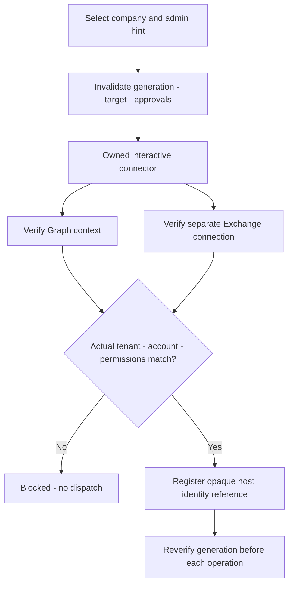
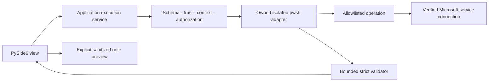
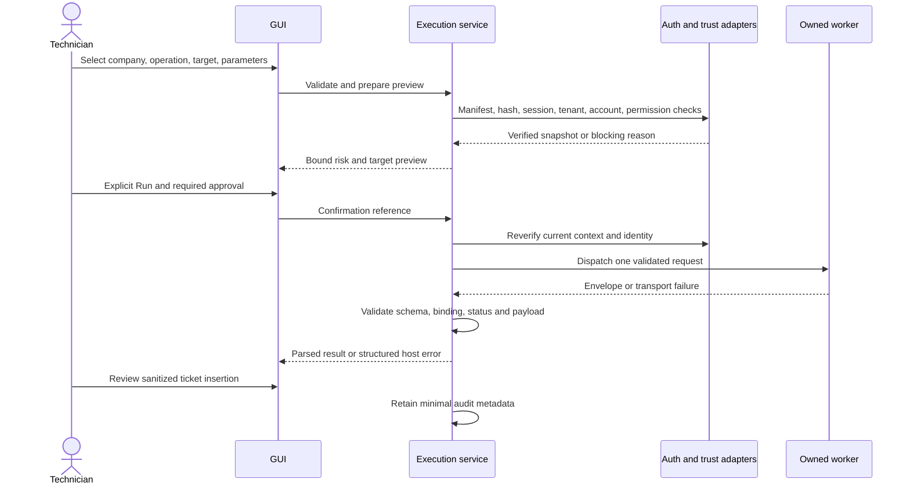

# Company, authentication, catalog and execution — proposal

Status: **PROPOSED**. No connector, worker or live Microsoft operation is implemented.

## Company, tenant and identity model

Profiles contain stable company_id UUID, display_name, tenant GUID, tenant domain,
admin UPN hint, optional short technician notes and allowlisted non-secret
preferences. See company-profile.schema.json. Each customer has their own admin
identity; no universal account or GDAP arrangement is assumed. Selection populates
hints, never proof. A domain/UPN/display name does not prove tenant identity.
Admin-hint edits invalidate authentication/approvals and are not silently persisted.

The host owns an opaque admin_identity_ref and session_generation in RAM, bound
to company/actual tenant/authenticated account/service. A ref is not a bearer
capability. Verify against the host registry, not caller claims. Company/admin
change clears target resolution, insertion approval and cached eligibility.
Dispatch uses an immutable snapshot. Stale queued generations are rejected before
any provider call; in-flight work is never retargeted to a new customer. Late
results are bound to the original company and quarantined from the current view.

## Authentication and switching

Propose Microsoft-supported delegated interactive sign-in with MFA/Conditional
Access. The technician may use a password manager independently in Microsoft's
UI. No T-Notes password field, injection, vault reader, custom token cache or
password/credential JSON. Admin UPN is only a login hint. Verify actual account,
tenant, required scopes and service RBAC after sign-in and before dispatch.

Graph's process-scoped context is the proposed baseline: Microsoft documents
`ContextScope Process` and Get-MgContext's tenant/account/scope/auth-type fields.
Scope consent alone does not establish effective RBAC.
[Graph authentication](https://learn.microsoft.com/en-us/powershell/microsoftgraph/authentication-commands?view=graph-powershell-1.0).

Exchange has a separate lifecycle: check the specifically owned connection's
UserPrincipalName, TenantID, state and token status. Never take the first connection
or assume Graph authentication supplies Exchange authorization.
[Exchange connection information](https://learn.microsoft.com/en-us/powershell/module/exchangepowershell/get-connectioninformation?view=exchange-ps).

Proposed initial session model: owned worker per active company/tenant/account/generation,
serialized operations and RAM-only reuse while that selection is current. On
company/account switch invalidate refs, generation, target and approvals; cancel
owned work, dispose old owned connections/processes, then establish/reverify the
new context. No simultaneous cross-company sessions initially. Never terminate
unrelated PowerShell. Native spike must verify module/runtime versions, broker
account selection, process isolation, service RBAC and cleanup. App-only/unattended
auth is deferred. Expiry disables execution; reconnect never automatically replays
an operation. Status per service: disconnected/connecting/verified/expired/mismatch/error.

## Catalog and trust

Initial display categories: Entra ID / Users; Exchange Online / Outlook;
Microsoft 365 Licensing; Microsoft Teams; SharePoint; OneDrive; Intune / Devices;
Security / Defender; Purview / Compliance; Reporting; Troubleshooting Workflows.
Category/subcategory/tags are presentation metadata independent of folders and IDs.
A single operation is one unit of outcome; a reusable script implements it; a
workflow orchestrates multiple approved scripts in the application service.
No giant all-administration PowerShell file.

Risk: read_only, write, high_impact. Metadata, cmdlet name and WhatIf do not prove
side-effect safety. Start with reviewed read-only diagnostics; writes need bound
preview/authorization. High-impact remains disabled pending its own policy.

Discovery scans a fixed approved catalog root, size-bounds reads, validates schema
and exact version, rejects duplicate IDs/unsupported runtime/modules/forms, and
resolves relative script/output-schema paths within their respective approved roots.
Reject absolute/UNC/device paths, drives, dot segments, alternate streams,
backslashes, encoded traversal and reparse/symlink escapes. Pattern validation
alone is insufficient; check actual resolved files. Compare script/version/hash,
manifest and payload-schema identities to an owner-approved release inventory
external to the manifest. A manifest cannot approve itself. Verify at dispatch;
mitigate check/use races with immutable ACL-protected staging or equivalent handle
policy. Exact signing/staging mechanism remains an approval decision.

Only schema-valid **and trusted** manifests create executable catalog actions;
untrusted entries are quarantined with a safe reason. Typed forms may be generated
from approved descriptors. Discovery never imports or executes scripts. Session,
permissions and authorization remain additional gates; favorites cannot bypass
them. Missing modules produce MODULE_MISSING, not automatic install/elevation.

## Worker and transport boundary

Recommend a supervised PowerShell 7 worker, fixed reviewed bootstrap and argv,
`-NoProfile`, `shell=False`, with no UI-supplied expression/script path. This is a
proposal pending native spike. Bind trusted operation IDs to typed parameters;
never Invoke-Expression or executable pasted command previews. Operation `.ps1`
files return the exact operation_return object specified in CONTRACT.md; only the host adapter serializes
the result envelope. Operations do not login or access application SQLite.

| Transport | Disposition |
|---|---|
| Bounded UTF-8 stdin/stdout | Preferred: avoids shell interpolation and request files; still needs framing, owned handles and context binding |
| Protected request file | Alternative only if needed: exclusive owner-only file, no link following, identity/read checks and owned cleanup; crash residue contains PII |
| JSON in argv/environment | Reject: quoting, inherited-state and visibility risks |
| Named pipe/RPC | Later approved option with ACL/framing/reconnect design, same contract gates |

One compact JSON request line and one JSON result line per operation; the
separately discriminated cancel_control frame in CONTRACT.md is allowed while
that one operation runs and produces no extra stdout envelope. Persistent
workers repeat serially, never with two outstanding requests. Stdout contains no
banners, progress, SDK dumps or diagnostic text. Progress initially uses host
lifecycle states; a separate channel requires protocol approval. Bound and redact
controlled stderr before retaining it. Reject BOM, duplicate keys, nonfinite
numbers, multiple envelopes, extra non-whitespace and incomplete UTF-8. One final
newline is allowed. A killed worker may emit no envelope: host creates an origin=host
failure without inventing script data or verified tenant context.

## Execution lifecycle

Sequence: company, script, manifest validation, parameter validation, integrity,
connection verification/establishment, tenant/admin/permissions, risk/target preview,
approval, dispatch, timeout/cancel, bounded capture, JSON Schema validation,
normalization, presentation, optional note preview/insertion, privacy-conscious audit.
Changing company/account/generation/target/parameters/script/version/hash/schema/risk
invalidates preview. Confirmation refs are host-owned, expiring and single-use;
JSON cannot declare itself authorized. Explicit read-only Run is intent; writes
also require bound confirmation. High-impact cannot dispatch initially.

One active operation globally initially. Execution service owns handles, deadlines,
completion arbitration and worker cleanup outside Qt's main loop. Workers never
access widgets or the application's SQLite connection. Pin tested runtime/module
versions and constrain PSModulePath/profile/autoload; do not inherit secrets through
environment. No runtime dependency installation as a side effect of Run.

Cancellation requests cooperative stop; after proposed 5-second grace, stop only
the owned job/process. Windows containment is a future native gate. A complete
validated result received before deadline wins terminal arbitration; otherwise
timeout/cancel becomes terminal and late output is ignored. Cancellation is not
rollback. If side effects might have occurred, operation_outcome=unknown; automatic
retry is forbidden. Even read-only retry needs explicit new intent after diagnosis.
retryable is guidance, not an automatic replay permission. Do not repeat completed
workflow steps while retrying a failed optional step.

Terminating errors become sanitized codes; approved ErrorAction policy captures
non-terminating errors, so no thrown exception is not proof of success. Unexpected
pipeline objects/output are CONTRACT_VIOLATION, not guessed successful data.

## Audit and privacy

### UTC history coverage (I1)

Every explicit Run creates one RAM history record before preflight with a fresh
correlation; record rejected invalid input/catalog/trust, failed authentication,
permission/tenant/account failures, queued cancellation, dispatch, valid success,
partial, operation error, transport crash, timeout and cancellation. A blocked
downstream workflow section is recorded as rejected/not_started, not a fabricated
worker result. Selected retries get new correlations linked by workflow_id; never
overwrite or relabel an earlier attempt. Completed sections remain tied to their
original context after a company switch. No record is evidence of durable audit.

Use `common#/$defs/history_record` for the sanitized application-only summary.
requested_at, nullable started_at and nullable completed_at are valid UTC RFC3339
ending Z. Queued has neither start nor completion; running has a start; terminal
statuses always have completion and monotonic duration_ms, even rejected before
dispatch (started_at=null). Enforce requested <= started <= completed where present
using parsed instants, not text ordering. Wall-clock reversal becomes a sanitized
clock/contract failure; never claim a valid negative duration. Durations measure
elapsed monotonic time; timestamps identify wall-clock instants. Raw validation
report timestamps use the same Z convention. A local display conversion must be
explicitly labelled and never alter stored timestamps. History duration includes
queue time from request to terminal decision and therefore has no operation-only
305-second ceiling. Queued/running records are host observations with outcomes
not_started/unknown respectively; a terminal worker outcome replaces only that
attempt's pending state, while previous attempts remain immutable.

Record origin/stage/status/outcome/safe codes, script and exact release binding
when known, opaque company/admin reference/generation and verified tenant only.
Untrusted/unknown release_binding remains null; history cannot grant approval.
Exclude target UPN, raw payloads, notes/images, account UPN, tokens and SDK errors.
Synthetic history is marked synthetic; persistent retention remains unapproved.

### Connection and trust interfaces (I3)

Future Python AuthService exposes `get_connection_state(service, selection,
now_utc) -> ConnectionState`, serialized by common#/$defs/connection_state for
mock review. selection freezes company_id/tenant_id/admin_identity_ref/generation
and expected account. Each service has its own record/lease; never derive Exchange
state from Graph. Only verified state with current owned registry evidence may
dispatch. verified_at records a fresh check immediately before dispatch; there is
no reusable time-to-live shortcut. expires_at=null means unavailable expiry data,
not an unlimited session: verify service liveness now. Unknown/disconnected,
connecting, expired, mismatch or error blocks. Foreign connection IDs or stale
owner/generation are rejected; no automatic operation replay on reconnect.

Graph probe checks Get-MgContext TenantId, Account, AuthType=Delegated,
ContextScope=Process and Scopes against the adapter-owned runspace record, then
independent effective-permission evidence. Its API does not prove RBAC or token
expiry; never invent those fields. [Get-MgContext](https://learn.microsoft.com/en-us/powershell/module/microsoft.graph.authentication/get-mgcontext?view=graph-powershell-1.0).
Exchange probe selects the exact owned ConnectionId and checks TenantID,
UserPrincipalName, State, TokenStatus and TokenExpiryTimeUTC when available, with
independent effective cmdlet permission evidence. Missing proof blocks; never
select the first available connection. [Get-ConnectionInformation](https://learn.microsoft.com/en-us/powershell/module/exchangepowershell/get-connectioninformation?view=exchange-ps).
Provider fields and local checks normalize into the same credential-free lease
shape; those records are observations, not caller-authorized capabilities.

Future CatalogTrustService exposes `verify_release(manifest_bytes, script_handle,
output_schema_bytes, approved_inventory, now_utc) -> TrustState`, represented by
common#/$defs/trust_state. State is trusted only if the external approval binds
exact contract/script version, raw manifest/script/payload-schema SHA-256 values
and all referenced schema dependencies; resolved files are contained, non-reparse
and covered by immutable ACL/staging or an equivalent verified handle policy.
TrustState carries release_binding, inventory_sha256, approval_ref, checked_at,
trusted and safe reason codes. A manifest's self-hash, a signature alone, valid
schema or a caller's trusted=true is insufficient. Recheck before use and invoke
the pinned reviewed bytes/handle; replacing a path after validation is rejection.
No connection, trust or filesystem implementation is delivered by these interfaces.

Retain only correlation, script/version/digest, opaque company ID, verified tenant
when known, status/outcome, safe codes, duration and user action by default. No raw
stdout/stderr, UPN/sign-in detail, token, password, challenge, SDK object or note
content in audit. Raw JSON view is redacted too. Export/insertion of customer data
needs visible review and applicable policy. Output is untrusted data, never agent
instructions, executable HTML or command text. Clear old-company payload views on
switch. Decide employer retention requirements before persistent execution history.
