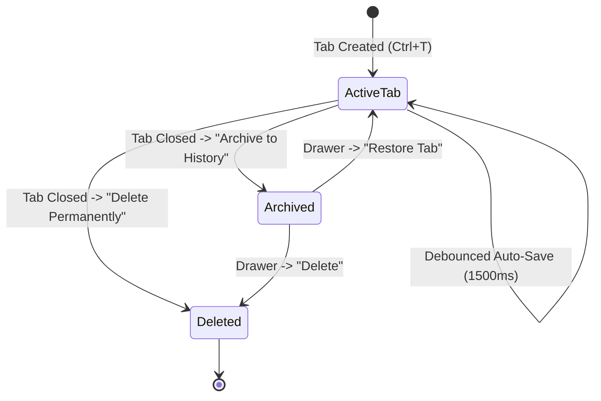

# History Drawer & Ticket Archival

## S001 history visibility during M365 navigation

The candidate hides the existing history dock while M365 is displayed and disables
its Notes toolbar/status/shortcut entry points. Back restores previous visibility
and enabled state; navigation neither refreshes nor replaces ticket history.
Archive/restore/delete behavior is unchanged. Close-to-tray or explicit Quit from
M365 persists the pre-navigation Notes drawer preference rather than its transient
hidden state. No execution-history store is introduced. Independent review and
integration remain pending.

## 1. Overview
The **History Drawer** is a collapsible side panel (`QDockWidget`) that stores completed or paused tickets. It combines SQLite FTS5 search with one-click tab restoration, allowing technicians to quickly reference past solutions without cluttering their active workspace.

---

## 2. Drawer Layout & Components

- **Dock Area:** Docked to the right side of the main window (`Qt.RightDockWidgetArea`), toggleable via `Ctrl+H`, the top toolbar compact button (`🕰️`), or the status bar button (`🕰️ History`).
- **Live Search Field (`QLineEdit`):** Positioned at the top of the drawer with clear button. Typing immediately filters tickets in real time.
- **Ticket List (`QListWidget`):** Displays archived tickets with:
  - Header: `#{ticket_number} — {client_name} ({title})`
  - Subtitle: `⏱️ {minutes}m | 📅 {YYYY-MM-DD} | {Snippet preview}` (time badge omitted if elapsed time is 0)
  - Detailed Tooltip: Surfaces comprehensive metadata on hover:
    - Ticket Number & Client Name
    - Title / Summary
    - Created timestamp (UTC)
    - Archived timestamp (UTC)
    - Total Active Troubleshooting duration in seconds
- **Action Buttons:**
  - `Restore Tab`: Re-opens the selected ticket as an active tab.
  - `Delete`: Prompts for permanent deletion of the ticket and its images.
- **Resizable Splitter & Ergonomic Dimensions:**
  - **Draggable Splitter Handle:** Styled via `QMainWindow::separator` (6px width, `#2d2d2d` dark background, `#007acc` blue highlight on hover) making the resize boundary between the central editor and History Drawer immediately visible and easy to grab.
  - **Default Width (`sizeHint`):** Defaults to `380px` (via `sizeHint(QSize(380, 600))` and `resizeDocks([self.history_drawer], [380], Qt.Horizontal)`), providing ample room for full ticket headers, time tags, dates, and preview snippets without horizontal truncation.
  - **Minimum Width Boundary:** Constrained to a minimum of `280px` (`setMinimumWidth(280)`) to prevent collapsing into an unreadable state while still granting full flexibility to resize wider on high-resolution displays.

---

## 3. Workflow & State Transitions



### 3.1 Archiving a Ticket & Appended Audit Trail
When a tab is closed via `✕`, `Ctrl+W`, or right-click **Archive to History**:
1. Active stopwatch elapsed seconds and debounced edits are flushed synchronously to SQLite.
2. `ScratchpadService.archive_ticket(scratchpad_id)` performs automated audit calculation:
   - **Tab Created:** Original creation timestamp (`created_at` in UTC).
   - **Tab Archived:** Instantaneous archive timestamp (`archived_at` in UTC).
   - **Total Tab Open Duration:** Complete wall-clock lifespan the scratchpad tab was active (e.g. `1h 45m 20s`).
   - **Active Troubleshooting Time:** Cumulative billable stopwatch time (e.g. `00:35:10` / `0.75h billable`).
3. An audit summary box is automatically formatted and appended to the ticket's `content_html`:
   ```html
   <div class="ticket-archive-audit" style="...">
       <div>📦 Ticket Archive Audit Summary</div>
       <div>• Tab Created: 2026-11-01 20:10:00 UTC</div>
       <div>• Tab Archived: 2026-11-01 20:55:00 UTC</div>
       <div>• Total Tab Open Duration: 45m 0s</div>
       <div>• Active Troubleshooting Time: 00:15:00 (0.25h billable)</div>
   </div>
   ```
4. `scratchpads.status` is set to `'archived'`, and `archived_at` is recorded in SQLite.
5. The tab is removed from the central tab widget and immediately appears in the History Drawer list with time tags and hover tooltips.

### 3.2 Real-Time FTS5 Search Filtering
1. The technician types a search query (e.g. `VPN timeout Cisco`).
2. `HistoryDrawer._on_search_changed()` delegates to `ScratchpadService.search_tickets(query, status='archived')`.
3. SQLite FTS5 searches indexed ticket numbers, client names, and note contents.
4. Results are ranked and displayed within milliseconds.

### 3.3 Restoring an Archived Ticket
1. The technician selects an archived ticket in the list and clicks **Restore Tab** (or double-clicks the item).
2. Alternatively, pressing `Ctrl+Shift+T` at any time restores the most recently archived ticket immediately without opening the drawer.
3. If the ticket is already open in an active tab, the tab widget immediately focuses that tab.
4. If not open:
   - `ScratchpadService.restore_ticket(scratchpad_id)` sets `status = 'active'` and calculates the next `tab_order`.
   - A new tab is instantiated with its saved HTML and images loaded from SQLite.
   - The drawer list refreshes, removing the item from archive.

### 3.4 Restoring into Side-by-Side Split View
1. Right-clicking any ticket item in the History Drawer list displays a context menu featuring:
   - **Restore Tab:** Re-opens the ticket in the primary tab bar.
   - **◫ Open in Side-by-Side Split:** Restores the archived ticket directly into the secondary pane of Split View.
   - **Delete Permanently:** Prompts for permanent removal.
2. Selecting **◫ Open in Side-by-Side Split** allows technicians to compare or extract information from an archived ticket alongside their active ticket without navigating away or losing context.


## Save-before-archive barrier

Direct primary/secondary Archive, both prompted Archive choices, and Close Other
Tabs use `_save_before_archive`. It snapshots and saves the live editor directly,
including dirty tickets whose 1500ms debounce timer stopped after an earlier
failure. It archives and removes an editor only after a current-revision committed
save acknowledgement. Missing dirty editors and persistence errors refuse archive,
retain HTML/undo/images and show Save Failed with Ctrl+S Retry guidance. Retrying
Archive itself also retries persistence without another edit. Close Other Tabs
stops at the first failure; earlier individually successful archives remain.
Archive audit metadata remains a subsequent operation; a failure there retains
the editor for recovery. There is no batch-wide archive transaction.
