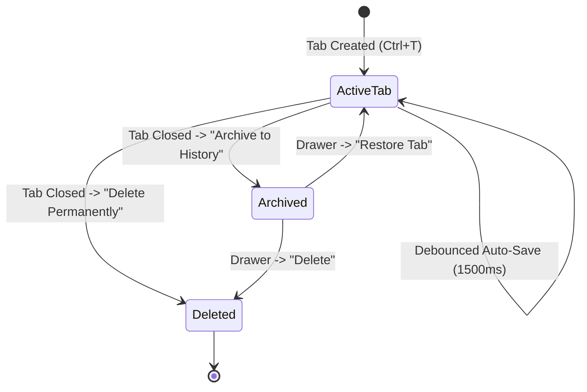

# History Drawer & Ticket Archival

## 1. Overview
The **History Drawer** is a collapsible side panel (`QDockWidget`) that stores completed or paused tickets. It combines SQLite FTS5 search with one-click tab restoration, allowing technicians to quickly reference past solutions without cluttering their active workspace.

---

## 2. Drawer Layout & Components

- **Dock Area:** Docked to the right side of the main window (`Qt.RightDockWidgetArea`), toggleable via `Ctrl+H` or the status bar button (`📜 History`).
- **Live Search Field (`QLineEdit`):** Positioned at the top of the drawer with clear button. Typing immediately filters tickets in real time.
- **Ticket List (`QListWidget`):** Displays archived tickets with:
  - Header: `#{ticket_number} — {client_name} ({title})`
  - Subtitle: `📅 {YYYY-MM-DD} | {Snippet preview}`
- **Action Buttons:**
  - `Restore Tab`: Re-opens the selected ticket as an active tab.
  - `Delete`: Prompts for permanent deletion of the ticket and its images.

---

## 3. Workflow & State Transitions

### 3.1 Archiving a Ticket
1. When a tab is closed via `✕` or `Ctrl+W`, the technician selects **Archive to History**.
2. `ScratchpadService.archive_ticket(scratchpad_id)` sets `status = 'archived'` in `scratchpads`.
3. The tab is removed from the central tab widget.
4. The History Drawer refreshes its list view immediately.

### 3.2 Real-Time FTS5 Search Filtering
1. The technician types a search query (e.g. `VPN timeout Cisco`).
2. `HistoryDrawer._on_search_changed()` delegates to `ScratchpadService.search_tickets(query, status='archived')`.
3. SQLite FTS5 searches indexed ticket numbers, client names, and note contents.
4. Results are ranked and displayed within milliseconds.

### 3.3 Restoring an Archived Ticket
1. The technician selects an archived ticket in the list and clicks **Restore Tab** (or double-clicks the item).
2. If the ticket is already open in an active tab, the tab widget immediately focuses that tab.
3. If not open:
   - `ScratchpadService.restore_ticket(scratchpad_id)` sets `status = 'active'` and calculates the next `tab_order`.
   - A new tab is instantiated with its saved HTML and images loaded from SQLite.
   - The drawer list refreshes, removing the item from archive.
