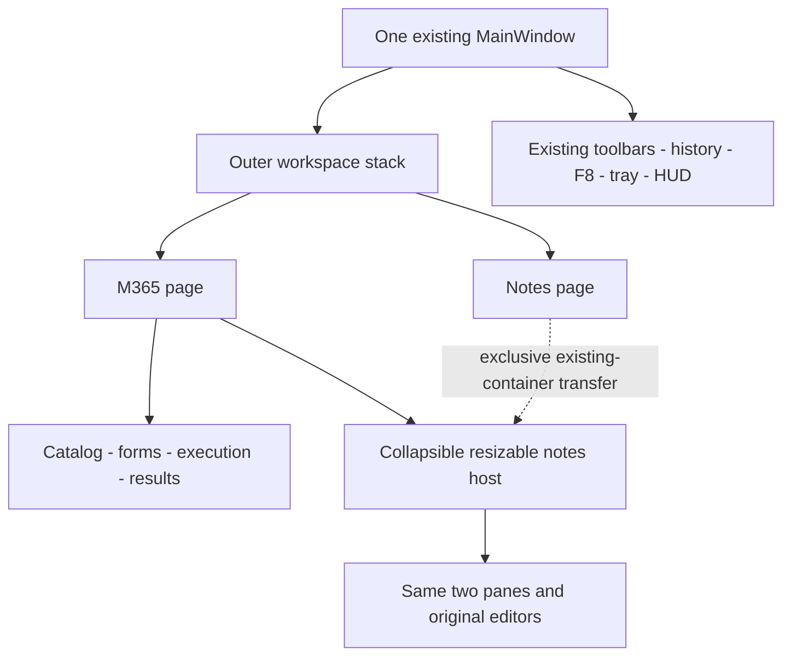

# M365 workspace architecture — proposal

Status: **PROPOSED**, not implemented; contract `0.3.0-proposed.1`.

## Product and navigation

One Windows PySide6 window hosts T-Notes and M365 Launcher. Recommend an outer
QStackedWidget, with a Notes page and M365 page. In a future authorized change,
use QMainWindow.takeCentralWidget before installing the stack; preserve the exact
existing workspace_splitter, both tab panes, editors, toolbars and services.
Never rebuild live editors from SQLite or setHtml during workspace navigation.
The M365 button switches pages; Back restores Notes appearance and focus, cursor,
selection, scroll, split sizes, pane membership and timer state. MainWindow keeps
opacity, tray, global F8 and lifecycle ownership. Formatting rows remain usable
for the active ticket panel; M365 controls belong to their page toolbar.

Qt transfers ownership when adding widgets to QStackedWidget; removal does not
delete or automatically reparent a page. These are constraints, not proof that
this app's transfer is safe. [Qt ownership reference](https://doc.qt.io/qtforpython-6/PySide6/QtWidgets/QStackedWidget.html).



## Complete GUI component contract

All entries are future requirements. V = independently reviewable synthetic
presentation; B = future backend gate. Demo status must never imply live service.

| Component | Responsibility | Gate |
|---|---|---|
| 1 Dashboard/toolbar | M365/Back, context summary, active execution and demo indicator | V; B real state |
| 2 Category navigation | Keyboard-accessible service navigation, preserve entered form state | V |
| 3 Company search/selector | Search authorized directory; explicit selection binds stable company ID | V; B profiles |
| 4 Profile details | Company, tenant GUID/domain, administrator hint; selected versus verified | V; B verification |
| 5 Administrator input | UPN login hint, no password; edit invalidates verification/approvals | V; B connector |
| 6 Target input | UPN/object ID exact lookup; never silently substitute admin | V; B identity |
| 7 Authentication status | Separate Graph/Exchange disconnected/connecting/verified/expired/mismatch/error | V demo; B sessions |
| 8 Script catalog | Schema-valid and trusted manifests; demo entries disabled or clearly simulated | V; B trust loader |
| 9 Category filters | Filter metadata independently of implementation folders or permissions | V |
| 10 Favorites | Stable script IDs; unavailable scripts remain unavailable | V; B settings |
| 11 Script details | Version, permissions, modules, risk, sensitivity, limits and disabled reason | V; B catalog |
| 12 Parameter forms | Typed supported controls, required/default/bounds validation, no unknown fields | V; B validator |
| 13 Command preview | Non-executable redacted operation/tenant/target/hash/risk summary | V; B trusted binding |
| 14 Execution workspace | Run eligibility, one active operation initially, Cancel, frozen dispatch context | V; B worker |
| 15 Parsed results | Typed escaped payloads, unavailable/partial distinct from healthy | V fixtures; B parser |
| 16 Raw JSON viewer | Redacted validated bounded envelope, never raw provider/stderr dump | V fixtures; B redaction |
| 17 Status/progress | Queued/validating/authenticating/approval/running/cancelling/terminal; indeterminate progress initially | V; B state machine |
| 18 Errors/warnings | Safe code/message/correlation/retry guidance; no stacks | V; B normalizer |
| 19 History | RAM summaries initially; synthetic provenance visible | V; B history model |
| 20 Note preview/insertion | Editable sanitized preview, explicit ticket/company/tenant confirmation | V preview; B insertion |
| 21 Ticket panel | Same ticket/editor/images/autosave/persistence/timer; collapse without destruction | V read-only; B editable transfer |
| 22 Preferences | Namespaced non-secret settings through SessionService; no install/elevation bypass | V; B adapter |

Demo mode must say **Synthetic demonstration — no Microsoft 365 connection or
operation**. Simulated Run cannot reach a live dispatcher. Real Run stays disabled
until manifest, trust, connection, context, permission and authorization checks pass.

## Active-ticket notes panel and widget ownership

Current save lookup searches the two tab panes, while each editor owns unsaved
JPEG bytes. Two writers saving different HTML can cause image pruning. Sharing
QTextDocument alone does not share cache/save/focus/timer ownership. Qt document
parenting also affects lifetime. [Qt QTextEdit reference](https://doc.qt.io/qtforpython-6/PySide6/QtWidgets/QTextEdit.html).

| Strategy | Decision for this proposal |
|---|---|
| Independent editable copy loaded from DB | Reject: stale content, competing saves, image deletion risk |
| Two widgets sharing QTextDocument | Defer: requires approved central document/cache/session ownership |
| Transfer only active editor out of tab | Defer: breaks current lookup and tab bookkeeping |
| Transfer complete existing workspace_splitter exclusively between page hosts | Preferred editable proposal: preserves both panes, lookup, caches and single save owner |
| Service-mediated read-only snapshot panel | Required fallback until editable transfer passes; Back to Notes for edits |

Editable panel may retain compact existing tab navigation with prominent active
ticket identification. It never displays two independently writable copies of the
same ticket. Keep split state while constrained/collapsed; do not close/remerge
split view to fit the panel. Transfers happen on the GUI thread with strong
references and destination layout parenting; no deleteLater, tab removal, editor
reload, new save timer or DB connection. Roll back a failed transfer to the old
host; retain notes and disable editable mode.

Flush pending saves before transfer; if saving fails, abort navigation and retain
unsaved caches. The acknowledgement and failure rules below are mandatory.
Snapshot active ticket/pane, cursor/undo/scroll, focus and timer
running/paused state. Reparent/focus events must not call load_scratchpad and
silently reset/restart timing. Collapse hides the host without destruction or a
second timer. Workspace switching does not itself count as a new ticket focus.

```mermaid
sequenceDiagram
  actor U as Technician
  participant C as Workspace coordinator
  participant E as Original editor and image cache
  participant D as Existing debouncer
  participant S as ScratchpadService
  participant R as Existing repositories
  U->>C: Switch workspace
  C->>D: Flush before transfer; abort on failure
  D->>E: Read current document and cache
  E->>S: Existing save_content path
  S->>R: Existing persistence
  C->>C: Move complete notes container, never clone
  U->>E: Edit or confirm note insertion
  E->>D: content_modified restarts existing timer
```

Read-only fallback reads bounded **unsaved current editor state**, not stale DB
HTML; copies local image resources without external retrieval; has no save
connections. It can reflect the existing timer, never own another. This fallback
does not meet final editable-panel acceptance: that gate remains BLOCKED until
container transfer or another separately approved design passes regression.

## Shortcuts, HUD, tray and restoration

Proposed routing preserves note shortcuts while notes/panel focus is active.
Ctrl+T/W/Tab/PageUp/PageDown and formatting must not mutate hidden tickets while
M365 form/results focus is active. Alt+Z acts on the notes container. Alt+T returns
the container to Notes before entering the existing Mini-HUD state machine; save
the return workspace in RAM and restore it on exit. F8 preserves visibility
behavior but focuses the current workspace/panel, not a hidden editor. These are
explicit future acceptance changes; existing global interception is not adequate
evidence. Preserve Return/Space/Escape, modal focus and shortcut accessibility.

Save/restore history dock visibility when navigating; keep its owner. Opacity
remains global. Tray hide flushes notes and may retain an already-authorized
read-only operation, clearly visible on return. Explicit Quit stops new dispatch,
requests cancellation and bounds owned-worker shutdown, preserving unknown
outcomes. Startup initially restores Notes through SessionService. M365 session
restore is deferred. Current restore preserves combined order/active ID, not
split-pane membership; do not promise existing full split restoration.

## Safe note insertion

Pin correlation, result digest, execution company/verified tenant, ticket ID and
preview revision. Existing client_name is free text, not a trusted tenant mapping:
require explicit technician association until a company-ticket link is approved.
Any company/target/ticket/preview change invalidates confirmation. On Insert,
recheck all bindings and insert sanitized plain text via QTextCursor in one undo
block; never replace the document, evaluate HTML or overwrite typed text. Mark
time/source/status/unavailable sections. A RAM single-use preview token prevents
double-click duplicates; a deliberate repeat needs a new preview. Let the existing
content_modified/debounce path persist it. Cancelled/unknown results cannot be
summarized as successful remediation.

## Persistence design

| Data | Proposed owner/storage | Boundary |
|---|---|---|
| Notes/images/timing | Existing services/repositories/SQLite | No worker writes or independent note object |
| Favorites and UI choices | Namespaced `m365.*` through SessionService/app_settings | Non-secret, bounded preferences |
| Companies | Synthetic RAM first; later CompanyProfileService/repository in same SQLite after migration approval | Admin UPN/notes are business/PII, never public fixtures |
| Catalog | Reviewed on-disk manifests, validated RAM index | Discovery is not trust |
| Execution history | RAM metadata by default | Retention and persistent summaries need explicit policy/schema review |
| Diagnostic payloads | Bounded RAM; explicit sanitized export/insertion | No automatic archival or full tenant dumps |
| Secrets | Provider-controlled transient/session mechanisms | No SQLite/config/request/log/source token/password/private key |

Do not put an entire company directory into one app_settings JSON value. Reuse
settings for preferences and reserve relational companies for an approved future
migration. Test migrations/integrity/FK with isolated fixtures. Existing
save_content performs separate HTML/image writes. It does not yet establish the
save acknowledgement contract below; an authorized persistence slice must satisfy
it before editable workspace transitions can be enabled.

## Save acknowledgement and failure contract (B2, normative)

The future application notes service exposes `save_ticket(ticket_id: int,
expected_revision: int) -> SaveReceipt`. The coordinator snapshots HTML, referenced
image URI set, retained JPEG bytes and editor revision on the GUI thread, and
persists through services/repositories only. `SaveReceipt` contains ticket_id,
attempted_revision, persisted_revision (integer or null), status (saved/error),
error_code (null or sanitized stable code). A saved receipt means durable commit
of that exact HTML revision and every referenced image, with no unsafe pruning.
An exception, lock, read-only DB, failed image write, failed commit or ambiguous
acknowledgement yields error; partial HTML success never yields saved. This is an
application contract, not an eighth PowerShell wire schema or an implemented API.

Each original editor has one monotonic revision and one dirty state covering HTML
and images. Every edit/image insertion increments the revision, marks dirty and
restarts the existing 1500ms single-shot timer. Captured/compressing images remain
owned pending work and cannot be forgotten during save or close. Save may complete
an older revision while typing continues: it must not clear the newer dirty state.
Only a saved receipt for the current revision, with all pending image work included,
permits a visible **Saved** acknowledgement. While pending show Saving; after
failure show **Save failed — unsaved changes retained**, with an explicit Retry.
Do not set Saved merely because a timer fired, a slot returned, an HTML update
succeeded, an operation result was inserted, or the window became hidden.

On failure retain the complete live document, undo/cursor/scroll state, all dirty
image bytes and resources, and the failed revision snapshot. Do not clear caches,
mark clean, reload from SQLite, prune referenced images or destroy an editor.
Existing separate writes can leave a partial database state: preserve the full
retry snapshot and diagnose; do not pretend rollback occurred. Future persistence
must commit HTML and images together or provide independently verified recoverable
staging before destructive pruning. This task adds no migration or save backend.

The application coordinator maintains a stable registry of every open ticket's
original editor/save owner, including both panes and hidden/collapsed/transferred
editors. Save and Quit enumerate that registry, not focus, visible tabs or the
currently selected workspace. A missing registered editor is a blocking error.
There is exactly one save owner/timer per ticket; never create a hidden second
writer. The original editor/cache remains alive while M365 forms have focus.

| Trigger | Required behaviour |
|---|---|
| Debounce | Attempt current revision; failure retains dirty state, displays failure and stops uncontrolled retry loops |
| Explicit Save | Save the intended ticket even if hidden; report that ticket/revision's receipt; no success toast for a different ticket |
| Notes↔M365, tab/ticket/company switch, container transfer, HUD entry | Finish pending image capture and flush affected dirty editors before committing navigation; any error aborts the transition and preserves original ownership/context |
| Panel collapse / tray hide | Preserve live owners, pending image work and save status; flush dirty notes; on failure cancel the hide/collapse and surface the retained failure |
| Explicit Quit / close routed to Quit | Stop new dispatch; await pending image work and flush every dirty registry entry; any failure rejects close, retains all editors/caches and presents Retry; no process exit, editor deletion or false Saved |
| Retry | Explicit technician action after error diagnosis; snapshot latest retained revision, include all referenced JPEGs, revalidate identity and serialize saves for that ticket; never retry stale HTML over newer edits |

Workspace transitions commit only after receipts cover each affected current
revision and pending image count is zero. Recheck revisions at the transition
barrier; a concurrent edit keeps the barrier closed. If one of several saves
succeeds and another fails, retain their truthful individual states and abort
the whole transition. Worker cancellation on Quit never overrides this notes
barrier. An OS crash or forced termination is not a successful Quit; crash recovery
remains a future gate and cannot justify an acknowledgement. Initial policy has
no implicit discard-on-close or failed-save timeout that loses unsaved data.

Required mock cases and native acceptance are separate: synthetic transition
examples in examples/mock-compatibility.json exercise the declared barrier only.
Actual database failure injection, delayed images, hidden-editor discovery, retry,
concurrent edits and rejected close must pass in the future implementation before
this behaviour can be described as implemented.
